# HRIS Platform

A modern multi-tenant HRIS/HRMS platform designed to centralize workforce operations from hiring to payroll.

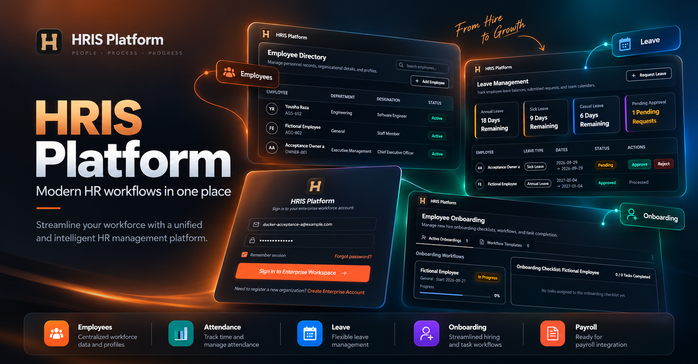

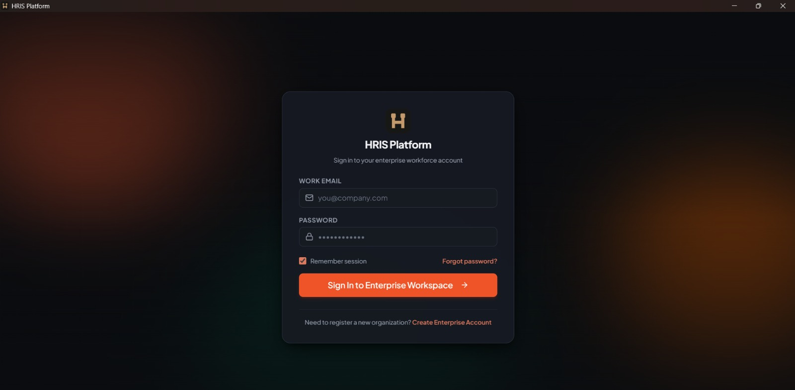

---

## Product Overview

HR teams often rely on spreadsheets and disconnected tools that lead to fragmented records, payroll errors, and delayed onboarding. **HRIS Platform** centralizes workforce operations into a single structured, high-performance system.

Built as an enterprise-ready, multi-tenant solution with both a modern web application and a dedicated native Windows desktop client, HRIS Platform brings core organizational functions together:

- **Employee Management** — Centralized profiles, department assignments, salary structures, and status tracking.
- **Departments & Designations** — Flexible organizational hierarchy and career leveling.
- **Attendance Tracking** — Digital kiosk check-in/out and real-time attendance logs.
- **Leave Management** — Custom leave categories, allocation balances, and self-service approval workflows.
- **Recruitment / ATS** — Job opening pipelines, applicant management, and candidate tracking.
- **Structured Onboarding** — Reusable task templates and automated new-hire progress tracking.
- **Document Vault** — Secure company and employee document storage with category organization.
- **Performance Appraisals** — Review cycles, multi-perspective ratings, and employee evaluations.
- **Payroll Processing** — Gross-to-net pay calculations, earnings, deductions, and finalized payslips.
- **Reports & Insights** — Headcount metrics, department distributions, and workforce analytics.
- **Roles & Permissions (RBAC)** — Granular permission matrix and access governance.
- **Organization Settings** — Multi-tenant configurations, company branding, and localized preferences.
- **Notification Workflows** — Real-time event notifications for leaves, payroll, and tasks.
- **Cross-Platform Access** — Responsive web application and native Windows desktop application.

---

## Core Features

### Employee Management
Complete employee directory and individual profile management. Tracks personal details, departmental assignments, job titles, reporting hierarchy, compensation data, and employment status with real-time auditability.

### Attendance
Streamlined digital attendance kiosk allowing employees to clock in and clock out daily. Provides HR administrators with immediate visibility into present, late, absent, and half-day records.

### Leave Management
Comprehensive time-off workflow supporting customizable leave types (annual, sick, casual, unpaid), balance quotas, employee request submissions, manager approval workflows, and historical leave tracking.

### Recruitment / ATS
Lightweight Applicant Tracking System (ATS) to create and publish job openings, manage applicant stages (applied, screened, interviewed, offered, hired), and transition successful candidates directly into onboarding.

### Onboarding
Standardized onboarding workflows built from customizable track templates. Assigns checklists and milestones to new hires while providing managers with real-time progress visibility.

### Documents
Secure, centralized repository for organization-wide policies and private employee records with categorized storage, scope controls, and access boundaries.

### Performance
Goal management and performance review cycles. Facilitates self-assessments, manager evaluations, scoring criteria, and performance history records.

### Payroll
End-to-end payroll period management. Automatically calculates gross earnings, tax and statutory deductions, net payouts, and generates finalized payslips with strict financial reconciliation.

### Reports
Workforce analytics dashboard delivering instant insight into organization headcount trends, department distributions, attendance patterns, and operational metrics.

### Roles & Permissions
Robust Role-Based Access Control (RBAC) engine allowing system administrators to define custom roles and granular permission sets across all modules.

### Notifications
Integrated notification center delivering real-time status updates for leave requests, payroll finalizations, onboarding tasks, and organizational announcements.

---

## Screenshot Gallery

### 1. Dashboard
*Central executive command center summarizing real-time headcount, department breakdown, leave metrics, and quick action shortcuts.*

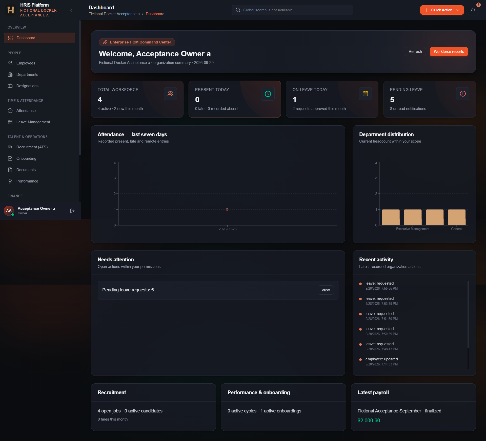

---

### 2. Employee Directory
*Comprehensive workforce directory with search, filtering, status badges, and rapid employee creation.*

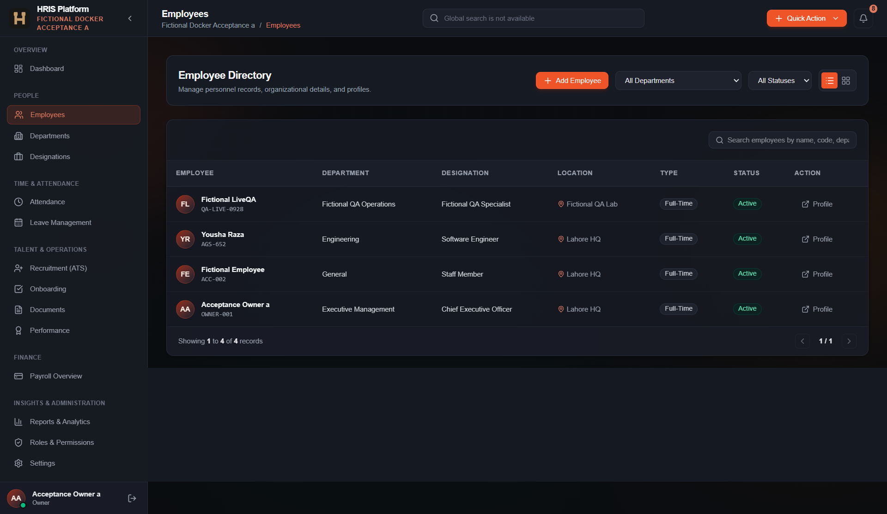

---

### 3. Department Management
*Organizational department directory mapping structure, cost centers, and team allocations.*

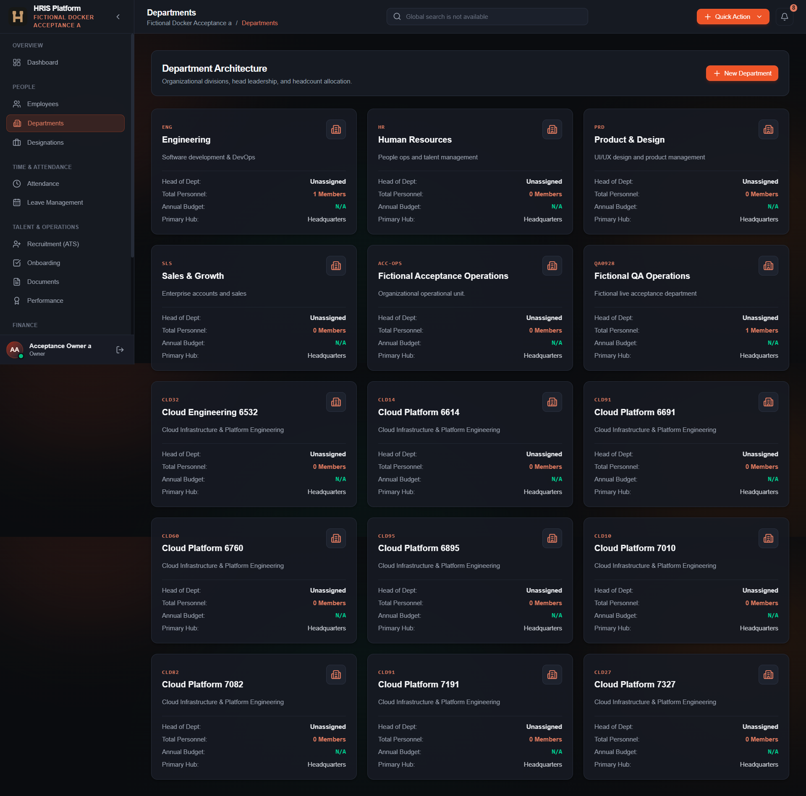

---

### 4. Designation & Hierarchy
*Job title catalog with organizational leveling and salary range definitions.*

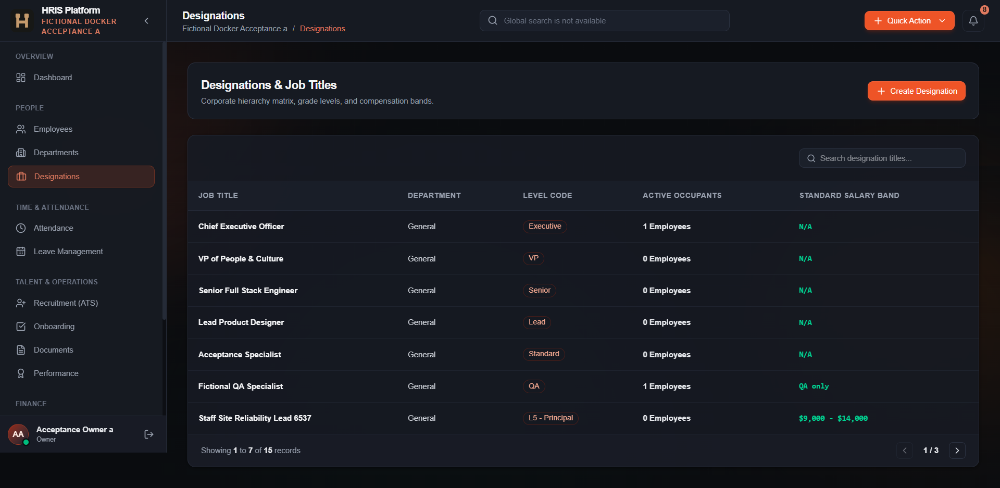

---

### 5. Attendance Kiosk
*Digital check-in/out interface and real-time daily attendance tracking records.*

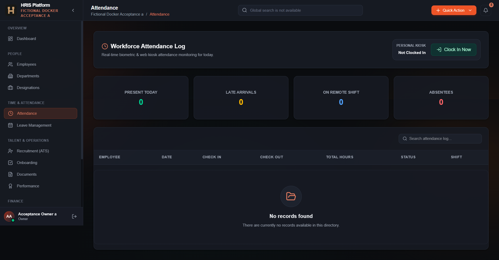

---

### 6. Leave Management
*Leave balance counters, time-off requests, and administrative approval workflow queue.*

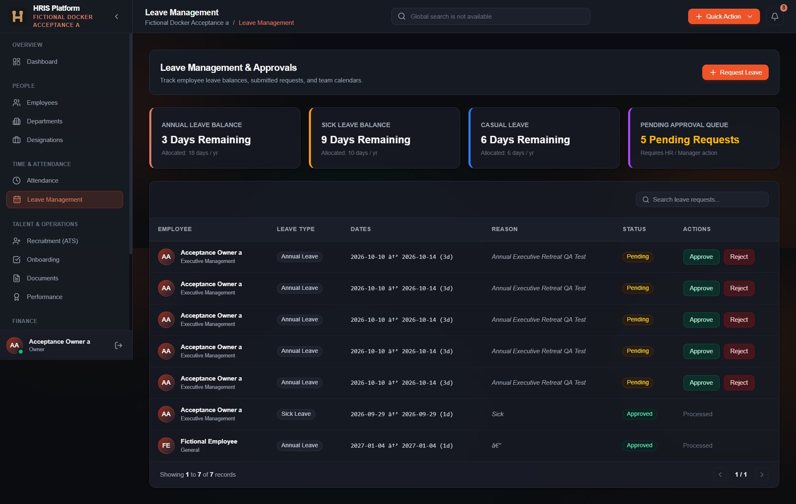

---

### 7. Recruitment & ATS
*Job opening management, vacancy pipeline, and applicant hiring lifecycle.*

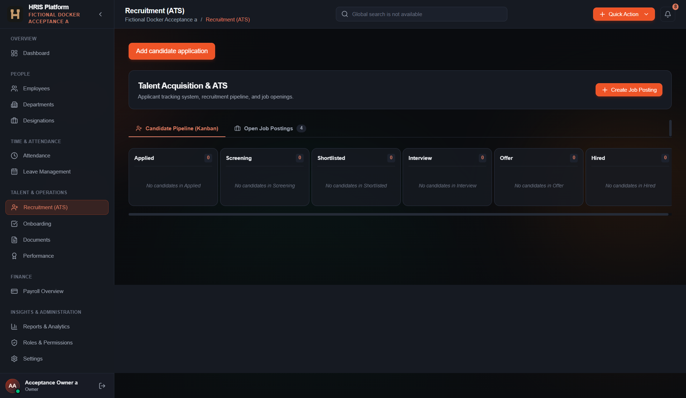

---

### 8. Onboarding Workflows
*Standardized new-hire onboarding checklists and track template management.*

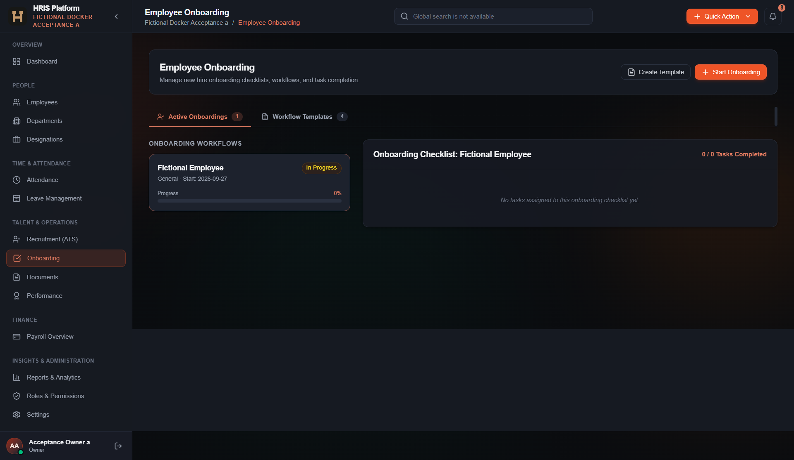

---

### 9. Document Vault
*Centralized company document library and confidential employee record vault.*

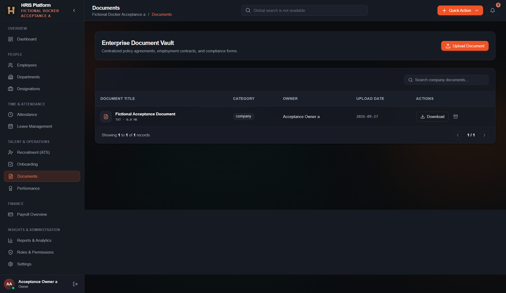

---

### 10. Performance Appraisals
*Performance review cycles, structured evaluation scoring, and employee appraisals.*

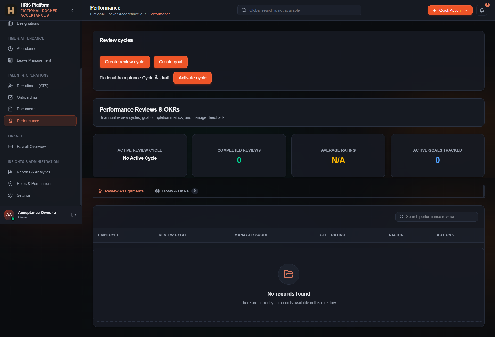

---

### 11. Payroll Console
*Payroll period processing, salary line item reconciliation, and payslip generation.*

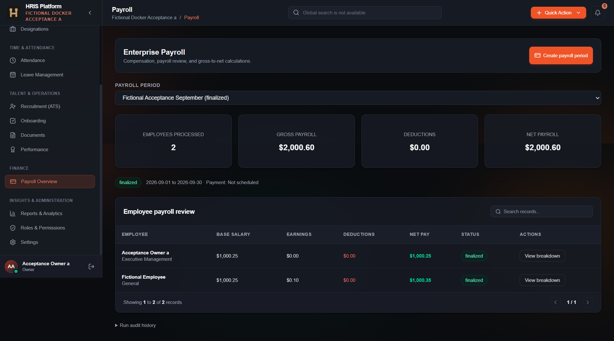

---

### 12. Reports & Analytics
*Visual workforce analytics, headcount distributions, and operational intelligence.*

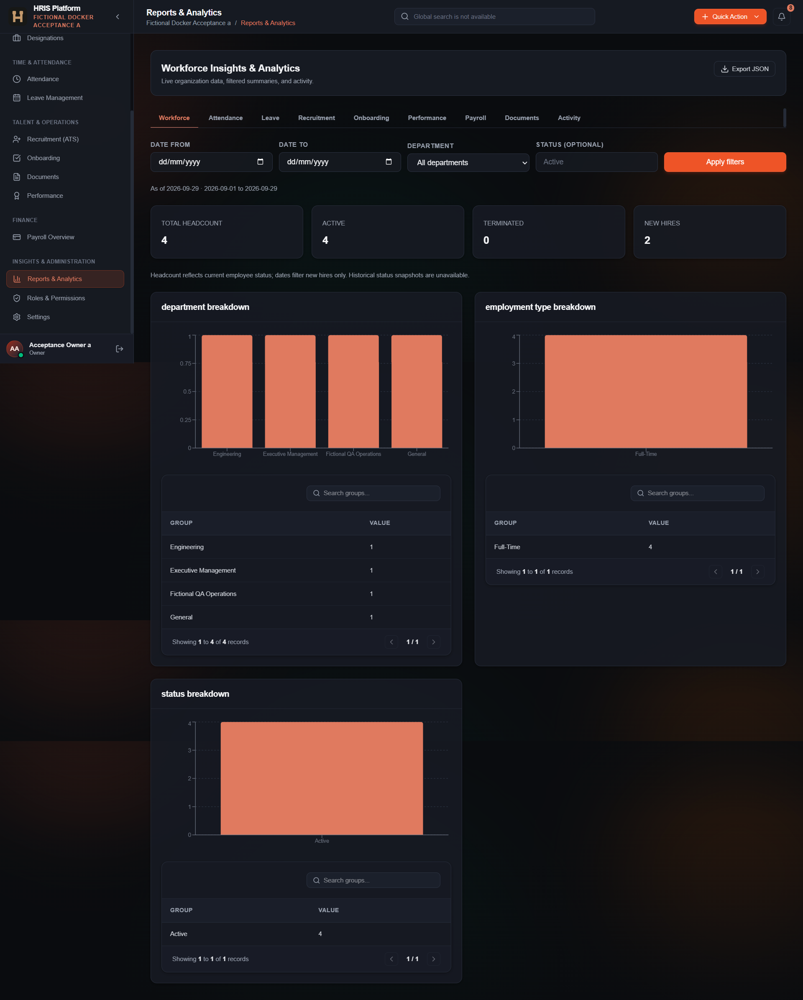

---

### 13. Roles & RBAC Matrix
*Granular permission control and role governance for enterprise access management.*

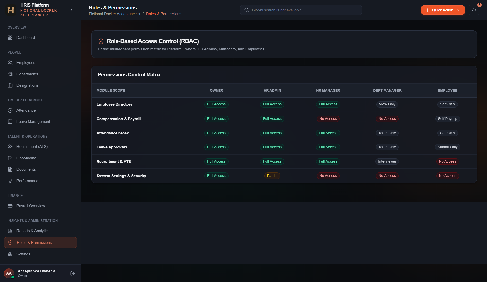

---

### 14. Organization Settings
*Tenant profile configuration, localized settings, and system-wide preferences.*

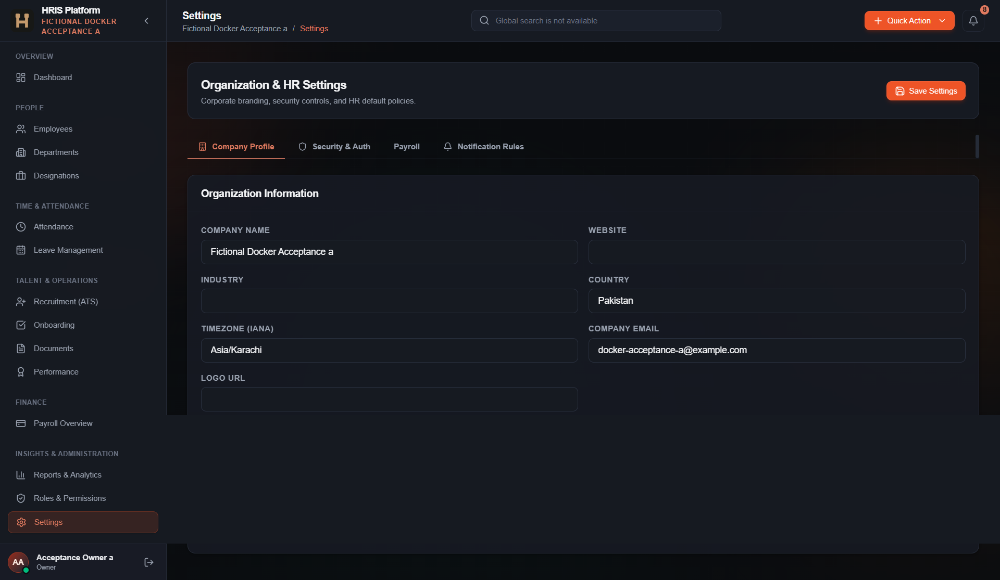

---

## Technology Stack

- **Frontend:** React, TypeScript, Vite, TailwindCSS
- **Backend:** FastAPI, Python, SQLAlchemy, Alembic
- **Database:** PostgreSQL
- **Infrastructure:** Docker, Docker Compose
- **Desktop Application:** Rust, Tauri v2

---

## Verified Quality & Architecture Standards

- **98 backend tests passed** across authentication, multi-tenancy, RBAC, leave, attendance, and payroll modules.
- **TypeScript strict validation passed** with 0 errors across all UI views and components.
- **Production frontend build passed** generating optimized static assets.
- **Cargo check passed** for the Rust Tauri native desktop wrapper.
- **npm audit clean** with 0 security vulnerabilities.
- **Docker Compose stack verified** with all 3 services (PostgreSQL, FastAPI Backend, React Frontend) healthy.
- **Multi-tenant isolation verified** ensuring strict database boundary enforcement between organizations.
- **PostgreSQL cold persistence tested** verifying data retention across complete container tear-down and reboots.
- **Payroll reconciliation verified** with strict Gross-to-Net formula audit across real records.
- **Full live end-to-end browser QA completed** across all 17 system workflows.
- **Windows native installer smoke-tested** for clean setup, Start Menu integration, and workspace launching.

---

## Commercial Availability

**HRIS Platform is proprietary commercial software.**

This GitHub repository is provided solely for product presentation, architecture demonstration, and evaluation. The proprietary production source code and commercial installers are not publicly distributed.

HRIS Platform is available for:

- Product demonstrations
- Pilot deployments
- Commercial licensing
- Custom HR workflows
- Private / self-hosted deployments
- Implementation services
- Bespoke customizations
- Business partnerships

### Inquiries & Contact

- **Email:** [realmoosaa@gmail.com](mailto:realmoosaa@gmail.com)
- **Portfolio:** [https://moosa-dev.vercel.app/](https://moosa-dev.vercel.app/)
- **GitHub:** [https://github.com/Moosa-05](https://github.com/Moosa-05)

---

## Interested in HRIS Platform?

For demonstrations, pilot deployments, licensing, customization, or implementation inquiries:

- **Email:** [realmoosaa@gmail.com](mailto:realmoosaa@gmail.com)
- **Portfolio:** [https://moosa-dev.vercel.app/](https://moosa-dev.vercel.app/)
